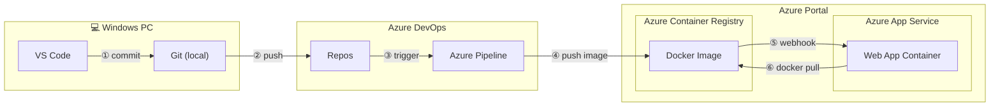

# Chaîne CI/CD : du PC jusqu'au conteneur sur Azure

Ce document explique, étape par étape, le chemin d'une modification de code :
depuis **VS Code** sur mon PC jusqu'à l'application qui tourne dans un **conteneur sur Azure App Service**.



| N° | Étape | Où | Qui la fait |
|----|-------|----|-------------|
| ① | Commit | PC (Git local) | moi |
| ② | Push | PC → Azure Repos | moi |
| ③ | Trigger | Azure Repos → Azure Pipelines | automatique |
| ④ | Build + Push de l'image | Azure Pipelines → registre | automatique |
| ⑤ | Webhook | registre → App Service | automatique |
| ⑥ | Docker Pull + redémarrage | App Service ← registre | automatique |

> Je n'interviens qu'aux étapes ① et ②. Tout le reste est automatisé : c'est le principe du CI/CD.

---

## ① Commit : enregistrer la modification en local

**Où :** sur mon PC, dans VS Code.

Je modifie le code, puis j'enregistre un « instantané » de mes changements dans le dépôt **Git local**.

```powershell
git checkout -b feature/ma-modif
```

```powershell
git add .
```

```powershell
git commit -m "Ajout du calcul de la moyenne"
```

- `git checkout -b` : crée une branche de travail (`main` est protégée, on ne travaille pas dessus directement).
- `git add` : sélectionne les fichiers à inclure.
- `git commit` : enregistre les changements **sur mon PC uniquement**. Personne d'autre ne les voit encore.

Dans VS Code, c'est l'onglet **Source Control** (Ctrl+Shift+G) → message → ✔ **Commit**.

---

## ② Push : envoyer le code vers Azure Repos

**Où :** du PC vers **Azure DevOps → Repos**.

```powershell
git push -u origin feature/ma-modif
```

- Le code part dans le dépôt distant hébergé par **Azure Repos**.
- Comme `main` est protégée par des **Branch policies**, je crée ensuite une **Pull Request** vers `main` :
  **Repos → Pull requests → New pull request**.
- La **Build Validation** lance le pipeline pour vérifier la PR (build + tests).
- Une fois la PR validée → **Complete** → les changements sont fusionnés dans `main`.

> `git push` envoie le **code source**. Ce n'est **pas** un `docker push`.

---

## ③ Trigger : le pipeline se lance tout seul

**Où :** Azure Repos → Azure Pipelines.

La fusion dans `main` provoque un push sur `main`. Le **trigger** du pipeline le détecte et lance une exécution :

```yaml
trigger:
  branches:
    include:
      - main
  paths:
    exclude:
      - '*.md'          # modifier la doc ne relance pas le pipeline
```

- Le pipeline démarre sur un **agent** (une machine fournie par Microsoft, définie par le `pool`).
- Il récupère le code de `main` (étape `checkout`, automatique).

---

## ④ Build + Push Image : construire l'image et la stocker dans le registre

**Où :** Azure Pipelines → **Azure Container Registry** (ACR).

Le pipeline exécute deux phases (stages) :

1. **CI** – compiler et tester. Si un test échoue, tout s'arrête ici.
2. **Continuous Delivery** – construire l'image Docker à partir du `Dockerfile` et la **pousser** dans le registre.

```yaml
pool:
  vmImage: 'ubuntu-latest'

variables:
  buildConfiguration: 'Release'
  acrConnection: 'acr-connection'            # service connection vers l'ACR
  imageRepository: 'devopswebapp'
  dockerfilePath: 'devopswebapp.Mvc/Dockerfile'
  tag: '$(Build.BuildId)'

stages:
- stage: Build
  displayName: 'Build & Tests'
  jobs:
  - job: BuildAndTest
    steps:
    - task: UseDotNet@2
      inputs:
        version: '10.x'
    - script: |
        dotnet restore
        dotnet build -c $(buildConfiguration) --no-restore
        dotnet test -c $(buildConfiguration) --no-build
      displayName: 'Restore, build, tests'

- stage: Docker
  displayName: 'Build & Push Image'
  dependsOn: Build
  condition: and(succeeded(), ne(variables['Build.Reason'], 'PullRequest'))
  jobs:
  - job: DockerBuildPush
    steps:
    - task: Docker@2
      inputs:
        containerRegistry: '$(acrConnection)'
        repository: '$(imageRepository)'
        command: 'buildAndPush'
        Dockerfile: '$(dockerfilePath)'
        buildContext: '.'
        tags: |
          $(tag)
          latest
```

**Le registre**, c'est l'« entrepôt » des images Docker. Chaque image est identifiée par
`nom-du-registre.azurecr.io/devopswebapp:tag`.

- Tag `$(Build.BuildId)` → une version précise, traçable (retour arrière possible).
- Tag `latest` → toujours la dernière version. C'est celle que l'App Service surveille.

**Service connection nécessaire :** *Project settings → Service connections → New → Docker Registry → **Azure Container Registry*** → choisir l'abonnement et le registre.

---

## ⑤ Webhook : prévenir l'App Service qu'une nouvelle image existe

**Où :** Azure Container Registry → Azure App Service.

Un **webhook** est une notification automatique : « *quand il se passe X, appelle cette URL* ».

- Événement : **push** d'une image avec le tag `latest`.
- Action : le registre appelle une URL secrète de l'App Service.

**Mise en place (une seule fois) :**

1. Ouvrir la Web App → **Deployment Center** (Centre de déploiement).
2. **Source** : *Container Registry* → **Azure Container Registry** → choisir le registre, l'image `devopswebapp` et le tag `latest`.
3. Activer **Continuous deployment** (Déploiement continu) → **Save**.

Azure crée alors automatiquement le webhook dans l'ACR (visible dans **ACR → Services → Webhooks**).

---

## ⑥ Docker Pull : l'App Service récupère l'image et redémarre

**Où :** Azure App Service ← Azure Container Registry.

À la réception du webhook, l'App Service :

1. fait un **`docker pull`** de `devopswebapp:latest` depuis le registre ;
2. **arrête** l'ancien conteneur ;
3. **démarre** un nouveau conteneur avec la nouvelle image.

La nouvelle version est en ligne, sans aucune action manuelle : c'est le **Continuous Deployment**.

**Réglages importants de la Web App (mode conteneur) :**

| Réglage | Valeur | Pourquoi |
|---------|--------|----------|
| Type de publication | **Conteneur** (pas « Code ») | l'app tourne depuis une image Docker |
| Système | **Linux** | images .NET Linux |
| Port | `WEBSITES_PORT = 5263` (Variables d'environnement) | l'app écoute sur 5263 et non 80/8080 |

> Alternative : passer le Dockerfile sur le port **8080** (`EXPOSE 8080` et `ASPNETCORE_URLS=http://+:8080`). Ce réglage devient alors inutile.

---

## Vue d'ensemble : CI, Continuous Delivery, Continuous Deployment

```
 ① commit → ② push → ③ trigger → [ Build & Tests ] → [ Build & Push Image ] → ⑤ webhook → ⑥ pull & restart
                                       CI              Continuous Delivery        Continuous Deployment
```

| Terme | Étapes | Résultat |
|-------|--------|----------|
| **CI** (Continuous Integration) | ③ + build/tests | le code est compilé et testé à chaque modification |
| **Continuous Delivery** | ④ | une image prête à déployer est stockée dans le registre |
| **Continuous Deployment** | ⑤ + ⑥ | l'image est déployée automatiquement en production |

---

## Variante sans frais : Docker Hub au lieu d'ACR

**Azure Container Registry n'est pas gratuit** (~5 $/mois en Basic). Avec un crédit *Azure for Students*,
on peut faire exactement la même chaîne avec **Docker Hub** :

| Étape | Avec ACR | Avec Docker Hub |
|-------|----------|-----------------|
| ④ Service connection | Docker Registry → *Azure Container Registry* | Docker Registry → *Docker Hub* (avec un jeton d'accès) |
| ④ `repository` | `devopswebapp` | `DOCKER_ID/devopswebapp` |
| ⑤ Webhook | créé automatiquement par Azure | copier l'**URL du webhook** affichée dans *Deployment Center* et l'ajouter dans **Docker Hub → dépôt → Webhooks** |
| ⑥ Source dans Deployment Center | Azure Container Registry | **Docker Hub** |

Le reste (commit, push, trigger, pipeline) est identique.

---

## Récapitulatif en une phrase par étape

1. **Commit** — j'enregistre mes changements dans Git sur mon PC.
2. **Push** — j'envoie mon code vers Azure Repos (puis Pull Request vers `main`).
3. **Trigger** — le push sur `main` lance automatiquement le pipeline.
4. **Push Image** — le pipeline teste le code, construit l'image Docker et la stocke dans le registre.
5. **Webhook** — le registre prévient l'App Service qu'une nouvelle image est disponible.
6. **Docker Pull** — l'App Service télécharge la nouvelle image et redémarre le conteneur : la nouvelle version est en ligne.
